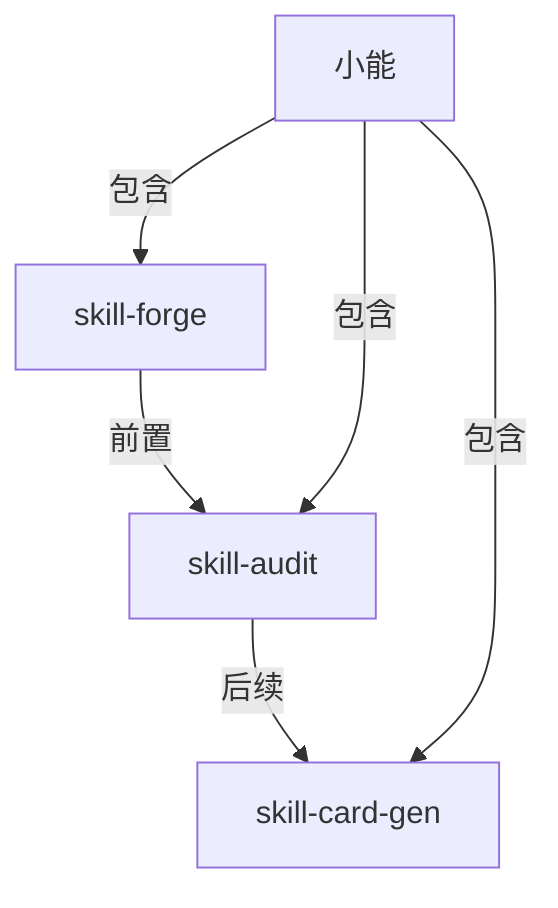

# Skill 图谱维护

> v2.0 | 升级：标准化Mermaid输出+具体推断规则+质量评估

## 触发词

- "技能图谱" / "Skill 关系" / "依赖关系" / "调用链" / "关系图谱"

## 关系类型

| 类型 | 符号 | 含义 | 判断规则 |
|------|------|------|---------|
| 前置 | ← | 调用A之前应先完成B | A的输入=B的输出，或A的SKILL.md明确说"先调用B" |
| 后续 | → | A完成后通常调用B | A的输出是B的输入，或A的SKILL.md说"结果交给B" |
| 依赖 | ⟵ | A必须有B才能运行 | A的工具链/脚本/API依赖B提供的数据或工具 |
| 互补 | ↔ | A和B一起用效果更好 | 同Agent下、同项目中经常一起调用 |
| 替代 | ≈ | A和B解决同一问题 | description关键词高度重叠（>70%），但方法不同 |
| 包含 | ⊃ | A包含B作为子流程 | A的skills/目录下有B，或A的流程中明确调用B |

## 流程

### Step 1：全量扫描 registry

读取 `memory/skill-registry.json`，获取所有 status=active 的 Skill。

### Step 2：推断关系（三类信号）

**信号一：声明关系（SKILL.md中明确提到，最高优先级）**
- 搜索关键词："与XX的关系"、"协作"、"调用"、"依赖"、"前置"、"后续"、"交给"、"先做"
- 命中 → 标注 `source: declared`

**信号二：结构关系（从目录结构推断）**
- A的skills/目录下有B → `contains`
- 同一Agent下的Skill → 标注 `same_agent: true`
- A的references/引用了B的名称 → `depends_on`

**信号三：语义关系（从description推断）**
- 计算description关键词重叠率
- 重叠>70% → `alternative`
- 重叠30-70%且同Agent → `complementary`
- 重叠<30% → 无关系

### Step 3：写入 registry

在每个Skill条目中添加 `relations` 字段：

```json
{
  "relations": [
    {"type": "prerequisite", "target": "skill-id", "source": "declared"},
    {"type": "contains", "target": "sub-skill-id", "source": "structural"}
  ]
}
```

### Step 4：输出标准关系图

**Mermaid格式（可直接渲染）：**



**JSON关系表：**

```json
{
  "nodes": [
    {"id": "skill-forge", "agent": "小能", "type": "meta"},
    {"id": "skill-audit", "agent": "小能", "type": "management"}
  ],
  "edges": [
    {"from": "skill-forge", "to": "skill-audit", "type": "subsequent", "source": "declared"}
  ],
  "stats": {
    "total_skills": 6,
    "with_relations": 6,
    "coverage_rate": 1.0,
    "declared_relations": 4,
    "inferred_relations": 3
  }
}
```

### Step 5：输出关系摘要

```
📊 Skill 图谱 · {日期}
━━━━━━━━━━━━━━━━━━━━

节点：{N}个 Skill | 边：{N}条关系 | 覆盖率 {X}%

🔗 关键调用链：
  skill-forge → skill-audit → skill-card-gen → agent-capability-map
  skill-registry-scan → (所有其他技能的数据源)

📁 包含关系：
  小能 ⊃ {skill-audit, skill-registry-scan, skill-card-gen, skill-graph, agent-capability-map, skill-forge}

⚠️ 孤立节点：{无任何关系的Skill}
💡 建议：{补建关系或考虑合并}
```

## 质量标准

- **关系覆盖率** = 有关系的Skill / 总Skill，目标≥80%
- **声明关系占比** = 声明关系 / 总关系，目标≥50%（推断关系不可靠）
- **孤立节点** = 0为最佳

## 输出文件

- `memory/skill-registry.json` — 更新relations字段
- `memory/skill-graph-{date}.md` — 本次图谱快照

## 注意事项

- 只记录有明确依据的关系，不臆造
- 推断的关系标注 `source: inferred`，声明的标注 `source: declared`
- 每次增量更新，不重写整个图谱
- Mermaid图中的节点ID必须与registry.json的name字段一致
