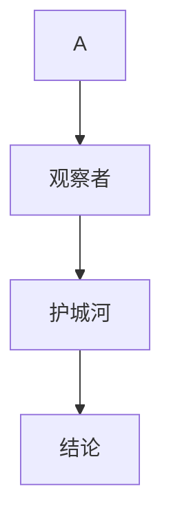
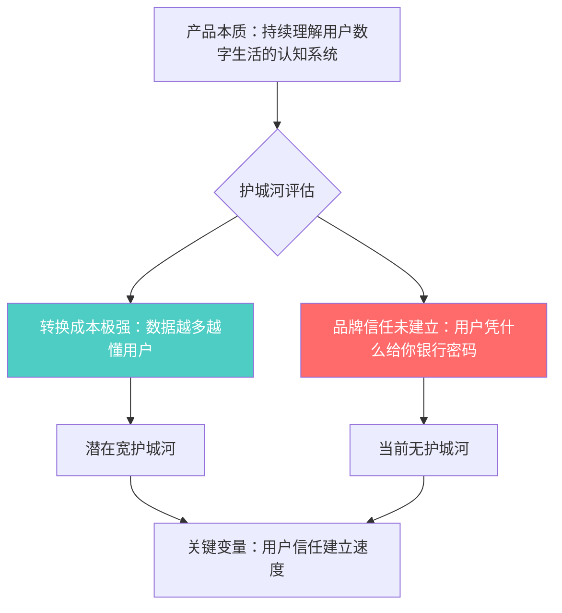
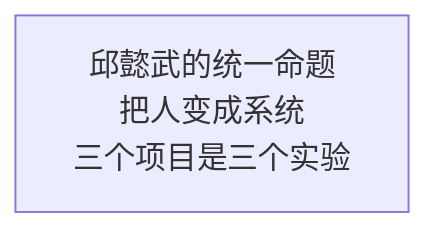
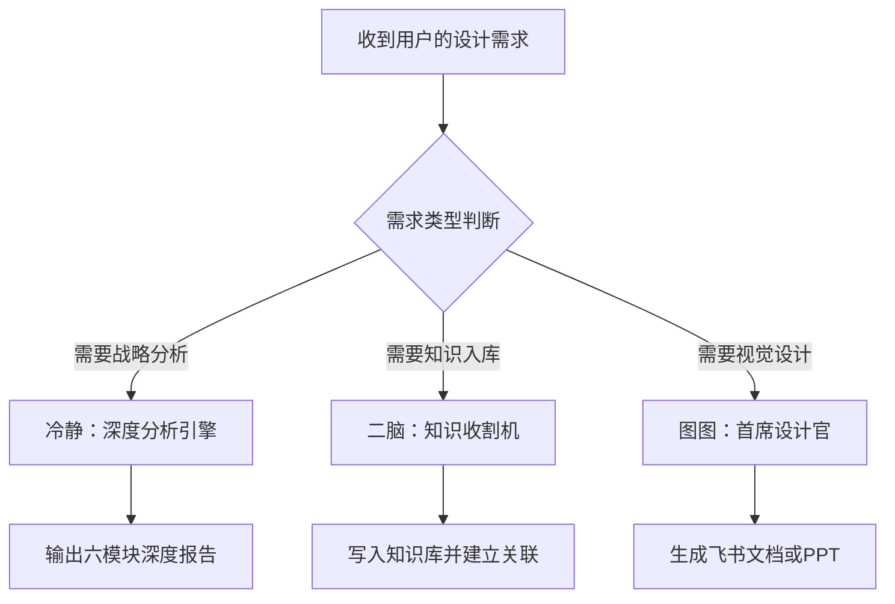
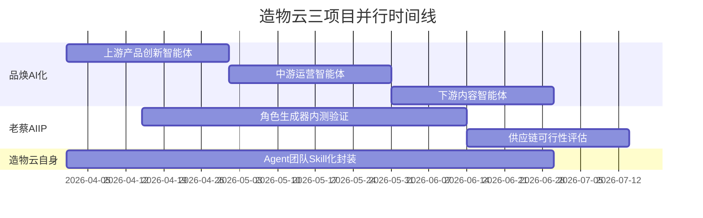
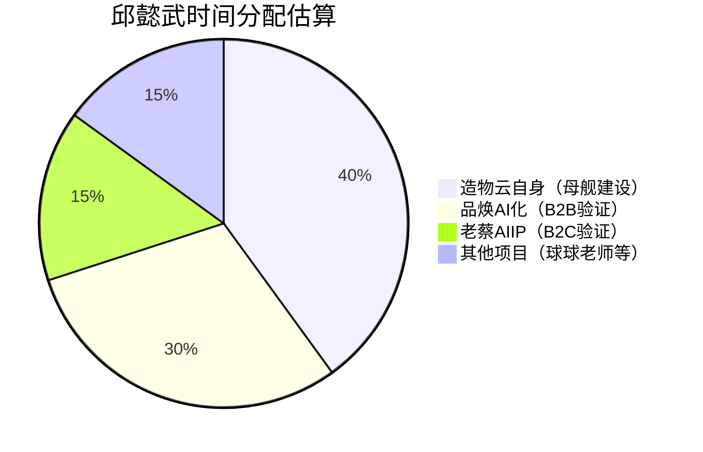
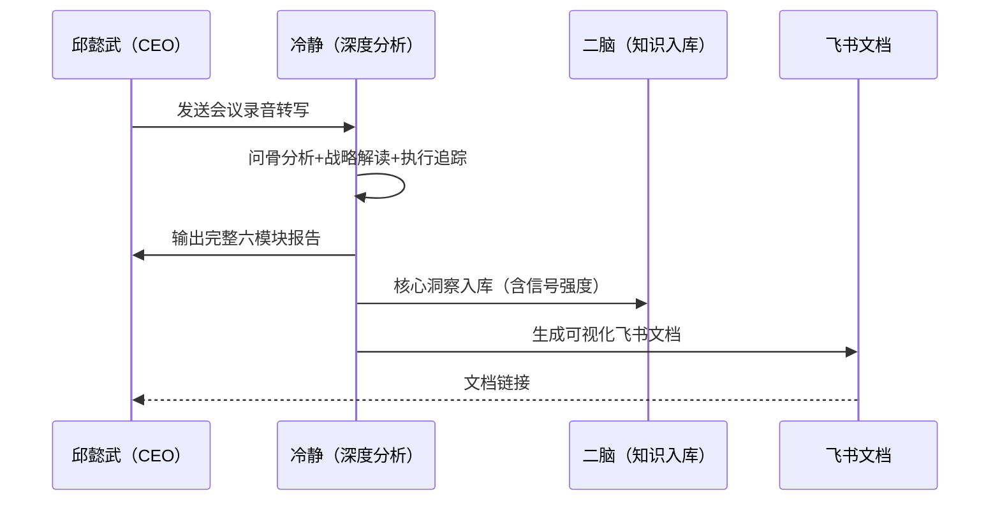
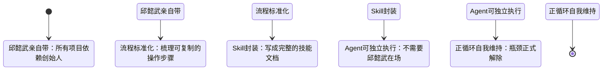
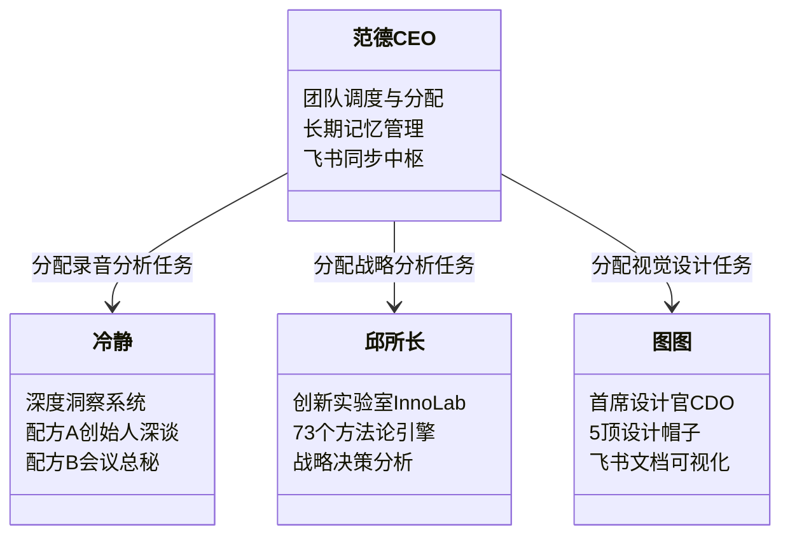

# 飞书文档设计师 · 可视化写作规范 v1.1

## 核心原则

飞书文档不是Word——它的优势是**结构化+可视化+协作**。不要用飞书当记事本，要把它当信息设计工具。

**三大铁律：**
1. **图是正文的一部分**，不是装饰——读不懂图就不该放
2. **图说结构，表说细节**——不要在图和表里重复同一层信息
3. **每个图必须自解释**——读者不看正文也能从图里看出核心结论

---

## 工作流程

```
收到飞书文档美化需求
  ↓
Step 1：判断需求（是新建文档还是美化已有文档？）
  ├─ 新建 → 走 Step 2
  └─ 美化已有 → 先读取原文档（feishu_fetch_doc），再走 Step 2
  ↓
Step 2：分析内容结构（识别：哪些是对比关系/哪些是流程/哪些是结论）
  ↓
Step 3：选择可视化方案（五种关系→五种视觉，图说结构+表说细节）
  ↓
Step 4：生成文档
  ├─ 新建：feishu_create_doc + feishu_update_doc
  └─ 美化：feishu_update_doc（overwrite模式）
  ↓
Step 5：质量自检（过8项清单，见文末）
  ├─ 通过 → 交付链接
  └─ 不通过 → 修正后重新提交
  ↓
Step 6：交付（发送飞书文档链接给用户）
```

## 安全边界

| # | 规则 | 说明 |
|---|------|------|
| 1 | **不自动创建文档** | 必须用户明确要求时才创建飞书文档 |
| 2 | **不覆盖非目标文档** | 美化模式下只修改目标文档，不碰其他文档 |
| 3 | **原文档备份** | 美化已有文档前，先用feishu_fetch_doc读取原文并记录 |

## 五种关系 → 五种视觉

| 内容关系 | 用什么 | 示例 |
|---------|--------|------|
| **对比关系** | 表格 | 三个方案对比、轻vs重、竞品分析 |
| **架构/流程** | Mermaid图 | 系统架构、工作流、决策树、因果回路 |
| **重点强调** | Callout块 | 核心结论、关键判断、风险预警 |
| **并列罗列** | 列表 | 行动清单、下一步建议、假设链 |
| **节奏控制** | 分割线 | 章节交替，每章节不超过一屏半 |

---

## Mermaid 使用指南

飞书支持 Mermaid 语法，直接用代码块包裹即可渲染。**每章至少一个图**，优先用图而非纯文字描述。

### 核心规则：节点标签写全称，不要缩写

**❌ 错误示范（太简略）：**


**✅ 正确示范（自解释）：**


**规则：**
- 节点标签用**完整短句**，不用缩写或单个词
- 每个节点应该能让读者**不看正文就理解这个环节是什么**
- 连线标注也要写清楚条件/关系，不只画箭头
- 如果标签太长放不下，说明这个节点应该拆成两个

### 节点标签长度参考

| 标签长度 | 效果 | 建议 |
|---------|------|------|
| 1-3个字 | ❌ 太短，看不出含义 | "结论""结果""开始" |
| 4-10个字 | ✅ 简洁清晰 | "用户信任尚未建立" |
| 10-20个字 | ✅ 信息量刚好 | "潜在宽护城河：转换成本加数据壁垒双叠加" |
| 20字以上 | ⚠️ 可能太长 | 考虑拆成两个节点或用换行 |

### 换行语法

节点内换行用 `<br/>`：


### 颜色规范

统一颜色语义，全文一致：

| 颜色 | 语义 | 用途 |
|------|------|------|
| `fill:#4ecdc4` (青绿) | ✅ 正面/成功/杠杆点 | 已验证的结论、最强优势 |
| `fill:#ff6b6b` (红) | 🔴 风险/瓶颈/问题 | 关键风险、系统瓶颈 |
| `fill:#f39c12` (橙黄) | 🟡 重要/核心/终局 | 核心命题、最终结论 |
| `fill:#3498db` (蓝) | 🔵 信息/一方/路径 | 某一方立场、某一路径 |
| `fill:#95a5a6` (灰) | ⚪ 过去/旧/已淘汰 | 旧范式、历史状态 |

用法：
```mermaid
style 节点ID fill:#4ecdc4,color:#fff
```

### 语法注意（防报错）

- 节点标签内**不能用双引号**（`"`），用单引号或不用引号
- 节点标签内**不能用 `()` `[]` `{}`**，用其他括号替代或直接不用
- `br/` 换行在某些图类型中不支持，用 `<br/>` 或空格
- 中文标点（如「」、『』）安全可用
- 连线标注（`|文字|`）也不能用双引号

### 1. 流程图（最通用）

**用途**：工作流、决策路径、产品流程



**方向选择**：
- `graph TD`（上→下）：适合纵向流程、层级关系
- `graph LR`（左→右）：适合横向流程、对比关系

**节点样式**：
- `[方框]`：普通步骤
- `{菱形}`：判断/决策点
- `(圆角框)`：起点/终点
- `((圆形))`：关键节点

**连线标注**：
- `-->|条件描述|`：带条件的箭头
- `-.->|弱关联/假设|`：虚线，表示弱关系或假设
- `==>|关键路径|`：粗箭头，表示强关联

### 2. 因果回路图（战略分析必用）

**用途**：增强回路、限制回路、系统动力学


### 3. 甘特图（时间线/排期）

**用途**：项目排期、里程碑、并行任务



### 4. 饼图（占比/分布）

**用途**：资源分配、团队构成、预算分布



### 5. 时序图（交互/协作）

**用途**：用户-系统交互、多方协作流程、信息流转



### 6. 状态图（状态变迁/演进）

**用途**：产品演进阶段、能力成熟度、项目生命周期



### 7. 类图（结构/关系）

**用途**：组织架构、产品模块关系、能力分层



### 选择指南

| 你想表达什么 | 用什么图 | 为什么 |
|------------|---------|--------|
| 步骤/流程/工作流 | graph TD/LR | 最直观，读者跟着箭头走 |
| A导致B导致C的循环 | graph LR + 标注增强/限制 | 因果回路，展示系统动力学 |
| 时间安排/项目排期 | gantt | 自带时间轴，一眼看并行 |
| 比例/占比/分布 | pie | 一眼看哪个最大 |
| 谁跟谁怎么交互 | sequenceDiagram | 展示信息流转和协作 |
| 状态怎么一步步变化 | stateDiagram-v2 | 展示演进和成熟度 |
| 谁包含谁/谁属于谁 | classDiagram | 展示结构和层级 |

### 图和表的分工

**图（Mermaid）负责回答：**
- 事情是怎么运转的？（流程图）
- A和B是什么关系？（因果/类图）
- 先做什么后做什么？（流程/甘特）
- 哪个因素影响最大？（因果回路+颜色标注）

**表负责回答：**
- 各选项具体怎么比较？（对比表）
- 每一项的具体数据/判断是什么？（评估表）
- 谁负责什么、什么时候完成？（行动表）

**不要做的事：**
- ❌ 图里画了一遍流程，表里又列一遍同样的步骤
- ❌ 表里写了因果关系，图里又画一遍因果回路
- ✅ 图画结构，表填细节，互补而非重复

---

## Callout 使用规则

飞书的 Callout 块用于**高亮关键信息**：

- ✅ 每个章节最多 **1个** Callout
- ✅ 用于：核心结论、关键判断、重大风险
- ❌ 不要用于：普通段段落、列表项、解释说明

Callout 用 Markdown 的引用块 `>` 实现。也可以用多个 `>` 表示多行：

```
> 这是核心结论的第一行
> 这是补充说明的第二行
```

---

## 表格设计原则

1. **表头行加粗** — 让读者一眼看到维度
2. **列数控制在5列以内** — 太多列手机端看不全
3. **对比表要有"判断"列** — 不只列事实，还要给结论
4. **用 emoji 做状态标记** — 🔴高风险 🟡中风险 🟢低风险 ✅完成 ⏳进行中
5. **表格标题行用加粗**（`| **列名** |`）确保飞书渲染时表头醒目

---

## 章节节奏

每个章节的结构：

```
## 章节标题（含emoji）
一两句引导语（告诉读者这章讲什么，提出问题）
↓
主体内容（Mermaid图呈现结构 + 表格呈现细节，二选一或互补）
↓
一个 Callout（本章核心结论）
↓
--- 分割线 ---
```

**单章节不超过一屏半**（飞书文档的屏幕）。超过就拆成两个章节。

**引导语的作用**：告诉读者"这章要回答什么问题"，让读者带着问题看图/表。不要直接丢一堆内容。

---

## 完整文档结构模板

```
# 标题（emoji + 简洁）

- **时间**：xxx
- **参与人**：xxx
- **分析方法**：xxx

---

## 一、一句话摘要

> Callout：用一句话说清楚核心结论

---

## 二、章节标题（提出问题：这章回答什么？）

引导语：用一两句话告诉读者这章要解决什么问题

```mermaid
（用Mermaid图呈现结构/流程/关系，标签写全称）
```

表格补充细节（如果图已经说清了结构，表就填具体数据）

> Callout：本节的核心判断

---

## 三、下一个章节

（重复以上模式）

---

## 总评

> 一段话收束全局

---

*分析工具名 · 日期*
```

---

## 飞书 Markdown 语法注意

- 飞书的 Markdown 解析器与标准有差异
- Mermaid 用 ```mermaid 代码块包裹，飞书会自动渲染
- 表格用标准 Markdown 表格语法
- Callout 用 `>` 引用块
- 不支持 HTML 标签（如 `<details>`、`<summary>`）
- 图片用 `<image url="..."/>` 语法（飞书特有）

---

## 质量自检清单

写完文档后，逐项检查：

- [ ] **每个图标签是否写全称？** 不看正文能否理解图的意思
- [ ] **图和表是否互补？** 没有在两个地方重复同样的信息
- [ ] **颜色是否一致？** 全文红色=风险，绿色=优势，橙色=核心
- [ ] **每章是否有引导语？** 读者知道这章要回答什么问题
- [ ] **每章是否有Callout？** 不超过1个，用于核心结论
- [ ] **章节是否超过一屏半？** 超过就拆
- [ ] **表格列数是否≤5？** 手机端能不能看全
- [ ] **Mermaid是否能正常渲染？** 检查引号、括号等语法

---

## 调用方式

当任何 Agent 需要把内容写成飞书文档时：
1. 先读本文件获取排版规范
2. 按"图说结构，表说细节"原则选择可视化方式
3. 节点标签写全称，不缩写
4. 用 `feishu_create_doc` 创建文档
5. 用 `feishu_update_doc` 填充内容
6. 写完后过一遍质量自检清单

---

*图图·飞书文档设计师帽子 · v1.1 · 2026-04-13*
*升级：节点写全称 / 颜色规范 / 图表分工 / 引导语 / 质量自检*